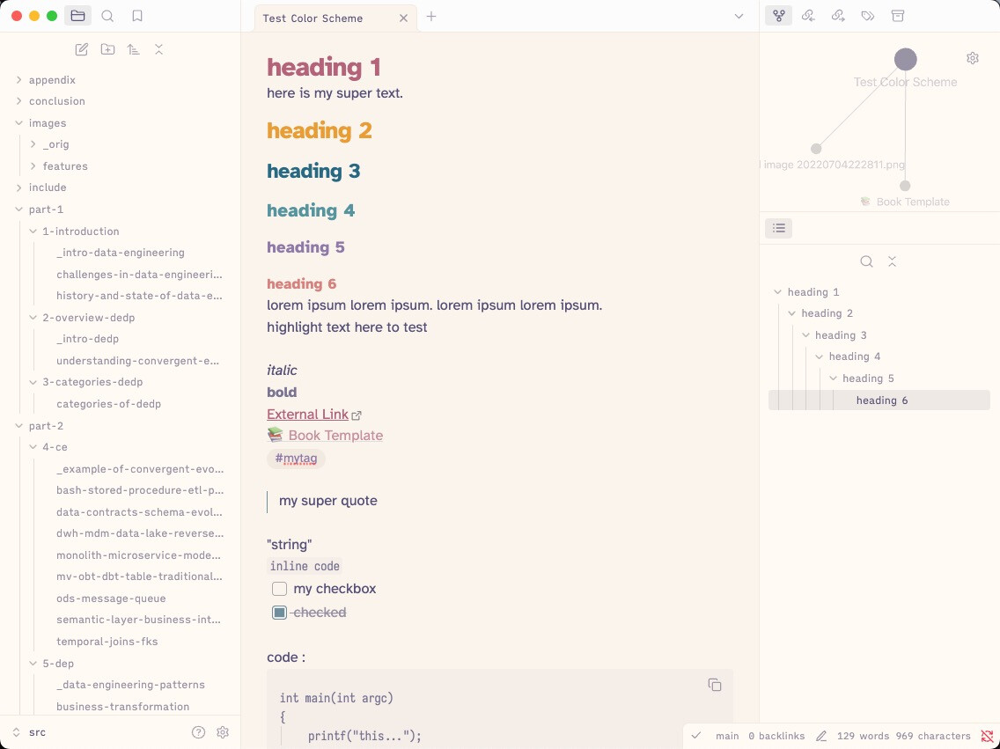

I have been revamping my website over the last few months. It started with how to get notes out of Obsidian onto my website a little easier. Plugged away at the for a bit by making a custom plugin to publish notes ( and related notes ) to the garden.

In that time I was going through another phase of revamping my Obsidian when I came across this new to me theme called [Rosé Pine](https://rosepinetheme.com/). I particular fell in love with the Dawn version of it.

I went and created a custom theme for Obsidian for it and then ended up [finding a version already out there](https://rosepinetheme.com/themes/obsidian/).

After discovering this theme it became my life 😆. I changed my:

- [VS Code Theme](https://marketplace.visualstudio.com/items?itemName=mvllow.rose-pine)
- [iTerm2 settings](https://github.com/rose-pine/iterm)
- A custom theme for Marked2 export ( I wanted my own custom doc output)

So naturally when it came time to update my website, I had to get Rosé Pine in there.

---

Before the theming, I really wanted to lean into the whole [digital garden](https://gil.dev/topics/digital-garden/) thing. I am trying to make this more more a collection of thoughts, ideas, things that catch my eye, etc. I want this to be less formal and more just about sharing things I find interesting.
